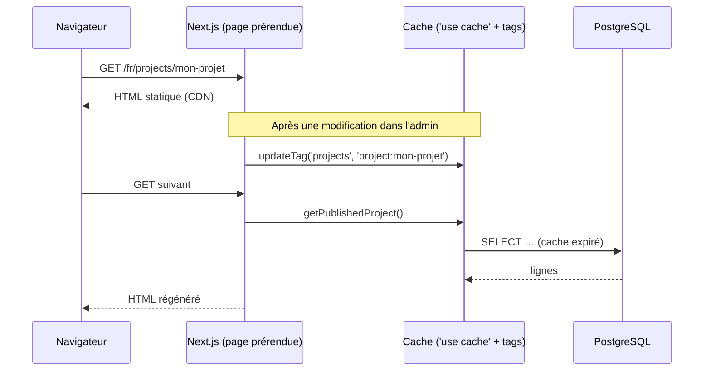
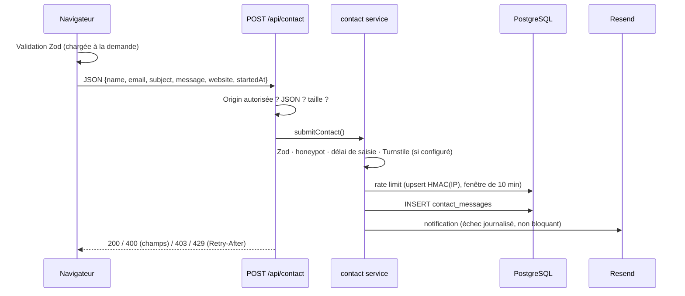
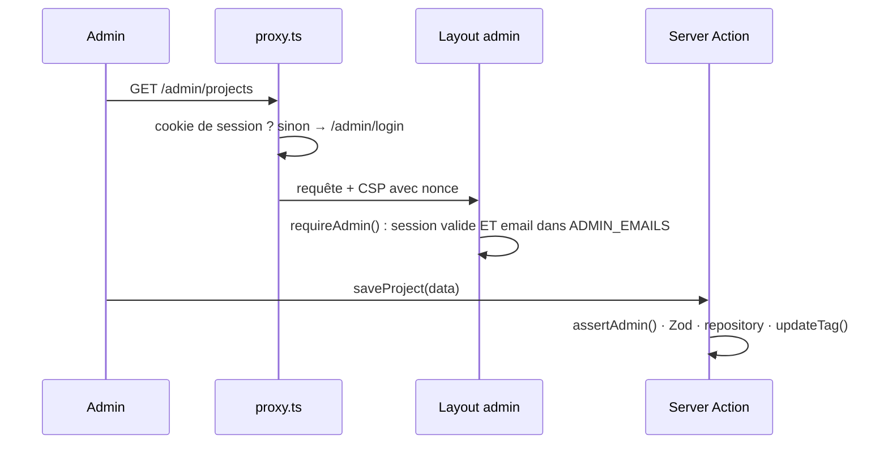

# Architecture

## Vue d'ensemble

```mermaid
flowchart LR
  subgraph Client["Navigateur"]
    Public["Site public FR/EN<br/>(HTML prérendu + îlots React)"]
    Admin["Admin /admin<br/>(rendu par requête)"]
  end

  subgraph Vercel["Vercel — Next.js 16"]
    Proxy["proxy.ts<br/>langue · garde admin · CSP nonce"]
    RSC["Server Components<br/>pages + 'use cache'"]
    Actions["Server Actions<br/>mutations admin"]
    Routes["Route Handlers<br/>/api/*"]
    Services["Services<br/>contenu · contact · stats · rate limit"]
    Repos["Repositories<br/>Drizzle ORM"]
  end

  DB[("PostgreSQL<br/>Supabase")]
  Storage[("Supabase Storage<br/>images · CV")]
  Resend["Resend<br/>emails"]
  GitHub["GitHub OAuth"]
  Turnstile["Turnstile<br/>(optionnel)"]

  Public --> Proxy --> RSC
  Admin --> Proxy
  Public -- "fetch / beacon" --> Routes
  Admin -- "formulaires" --> Actions
  RSC --> Services
  Actions --> Services
  Routes --> Services
  Services --> Repos --> DB
  Services --> Storage
  Services --> Resend
  Services --> Turnstile
  Admin -- "connexion" --> GitHub
```

## Couches

| Couche           | Dossier                             | Responsabilité                                  | Ne fait jamais                |
| ---------------- | ----------------------------------- | ----------------------------------------------- | ----------------------------- |
| UI               | `src/app`, `src/components`         | Rendu, interactions, motion                     | SQL, accès direct aux secrets |
| Actions / routes | `src/server/actions`, `src/app/api` | Authentification, parsing HTTP, codes de statut | Logique métier complexe, SQL  |
| Services         | `src/server/services`               | Règles métier, cache, anti-spam, notifications  | Connaître le format HTTP      |
| Repositories     | `src/server/repositories`           | Requêtes typées et paramétrées (Drizzle)        | Validation métier             |
| Données          | `src/server/db`                     | Schéma, migrations, seed                        | —                             |

Les validateurs Zod (`src/lib/validators`) sont partagés : le formulaire de contact et l'admin valident côté client avec les mêmes schémas que le serveur, et la documentation OpenAPI en est générée.

## Flux principaux

### Lecture publique (mise en cache)

### Formulaire de contact

### Administration

## Sécurité (résumé)

- Sessions Auth.js en JWT chiffré (cookie HttpOnly, Secure en production, SameSite=Lax, 8 h).
- Liste blanche revérifiée à chaque requête et dans chaque Server Action.
- CSP stricte à nonce sur l'admin ; CSP restrictive sur le site public prérendu.
- Contrôle d'origine sur toutes les mutations (Server Actions natif + `isAllowedOrigin` pour les routes POST).
- Requêtes SQL paramétrées via Drizzle ; aucune concaténation de SQL avec des données utilisateur.
- Uploads : vérification de la signature binaire, taille maximale, noms générés (UUID), pas de SVG.
- Aucune IP stockée en clair (HMAC avec `IP_HASH_SECRET`), statistiques sans cookie.

## Observabilité

- `GET /api/health` : statut, latence de la base, version (commit Vercel), uptime. Renvoie 503 si la base est inaccessible.
- Logs JSON structurés (`src/server/logger.ts`) : `ts`, `level`, `msg`, contexte et erreur sérialisée, compatibles avec les log drains Vercel.
- Pages d'erreur 404 et 500 bilingues, plus `global-not-found` et `global-error`.
