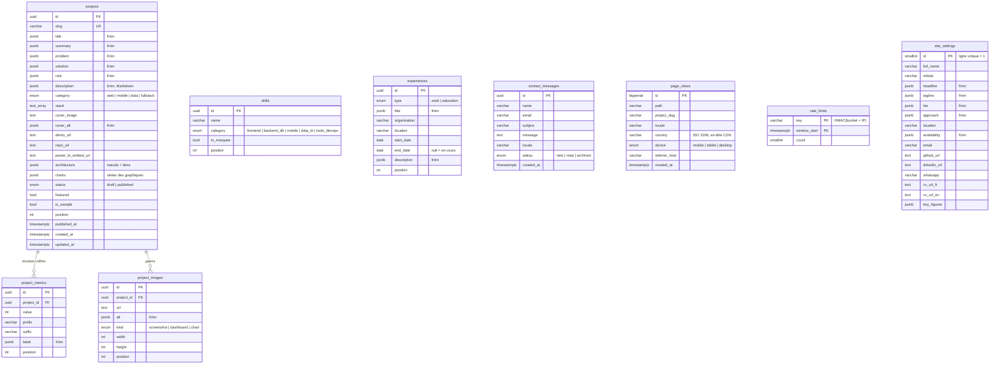

# Modèle de données

Source de vérité : `src/server/db/schema.ts` (Drizzle). Migrations SQL versionnées dans `drizzle/`.

Les textes traduits sont stockés en `jsonb` au format `{ "fr": "…", "en": "…" }` et validés par Zod (`localizedSchema`). Pour ce volume de contenu, c'est plus simple qu'une table de traductions par entité, et l'admin édite les deux langues côte à côte.

## Index

| Table                               | Index                               | Usage                                                |
| ----------------------------------- | ----------------------------------- | ---------------------------------------------------- |
| `projects`                          | `(status, position)`, `slug` unique | Liste publique ordonnée, page détail                 |
| `project_metrics`, `project_images` | `project_id`                        | Chargement des relations                             |
| `skills`                            | `(category, position)`              | Badges groupés                                       |
| `contact_messages`                  | `(status, created_at)`              | Boîte de réception, compteur de non-lus              |
| `page_views`                        | `created_at`, `project_slug`        | Agrégations du tableau de bord                       |
| `rate_limits`                       | PK `(key, window_start)`            | Upsert atomique ; purge des fenêtres de plus de 24 h |

## Données personnelles

- `contact_messages` contient les données que le visiteur envoie volontairement (nom, email, message). Elles peuvent être supprimées depuis l'admin.
- `page_views` ne contient aucune donnée personnelle : ni IP, ni cookie, ni identifiant, ni user-agent complet.
- `rate_limits` ne contient qu'un hachage HMAC non réversible, purgé après 24 h.
